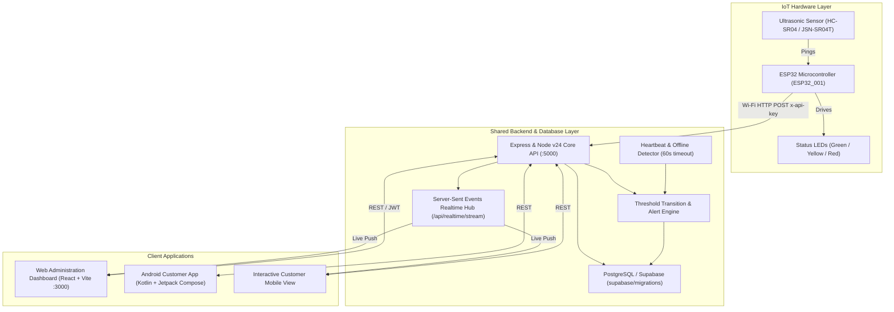

# MajiSmart Zambia — System Architecture & Telemetry Specification

MajiSmart Zambia is an integrated IoT water monitoring and community reporting platform designed for Zambian municipalities, commercial water utilities, and local communities.

---

## 1. IoT Telemetry Contract (Matching Hardware Sensor Format)

Telemetry from field ESP32 microcontrollers is transmitted via Wi-Fi as an HTTP POST request to `/api/iot/readings` (or `/api/readings`) authenticated by the `x-api-key` header.

### Exact JSON Contract:
```json
{
  "device_id": "ESP32_001",
  "tank_id": "TANK_001",
  "distance_cm": 15.5,
  "water_depth_cm": 34.5,
  "water_level_percent": 69,
  "status": "NORMAL"
}
```

### Physical Measurement Model:
- **Calibrated Tank Usable Height**: 50.0 cm
- **Ultrasonic Distance Measured**: 15.5 cm (Distance from sensor to water surface)
- **Water Depth**: $50.0\text{ cm} - 15.5\text{ cm} = 34.5\text{ cm}$
- **Water Level Percentage**: $(34.5 / 50.0) \times 100 = 69\%$
- **Calculated Status**: `NORMAL` (Thresholds: Critical $\le 15\%$, Low $\le 25\%$, Normal $> 25\%$)

---

## 2. End-to-End System Data Flow



---

## 3. Database Schema Overview

The database is defined in `supabase/migrations/20261024000001_initial_schema.sql` (the canonical copy applied by `supabase db push`) with Row Level Security (RLS) policies. Note that today the API connects as the `postgres` role through `pg`, which bypasses RLS — see `DEPLOYMENT.md` §4.3 before relying on these policies:

1. `profiles`: User identity and role (`admin`, `customer`, `technician`).
2. `monitoring_stations`: Geographic hubs (e.g. Lusaka Central, Chilenje, Matero, Chelston, Ndola).
3. `tanks`: Storage reservoirs with geometry, capacity, and configurable thresholds.
4. `monitoring_devices`: Registered ESP32 devices, API key hashes, and heartbeat tracking.
5. `water_level_readings`: Chronological telemetry time-series matching the photo format.
6. `water_alerts`: Generated automatically when thresholds are breached (LOW, CRITICAL, OFFLINE, RECOVERED).
7. `community_reports`: Citizen reports (shortages, leaks, burst pipes, quality concerns).
8. `report_status_history`: Complete audit trail of lifecycle updates (`SUBMITTED` $\to$ `ACKNOWLEDGED` $\to$ `IN_PROGRESS` $\to$ `RESOLVED` $\to$ `REJECTED`).
9. `system_settings`: Key-value configuration store.
